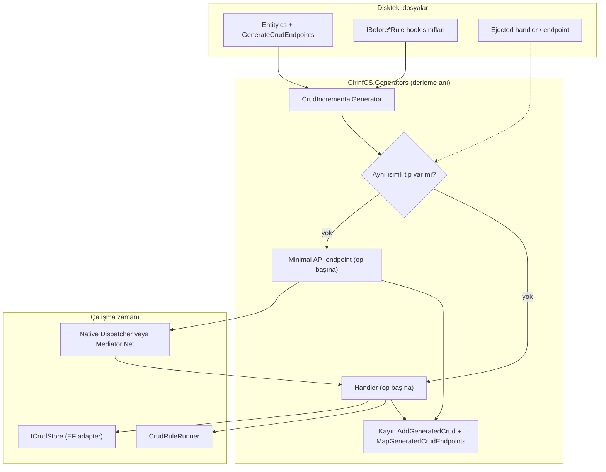

# AOT CRUD Source Generator — Entegrasyon Planı (v3)

Referans doküman: [aot_source_generator_core.md](file:///home/burak/Projeler/clrinf/.context/aot_source_generator_core.md)
(Kavramsal kaynak; `Commerce.*` isimleri ve faz numaraları bu planla **geçersizdir**, bu plan esastır.)

**Hedef:** Standart CRUD kodu diske yazılmaz, derleme anında üretilir. Diskte yalnızca entity, hook kuralları ve bilinçli `eject` edilmiş operasyonlar kalır. Böylece ajanın bağlamına giren dosya sayısı entity başına 6'dan 1'e düşer.

---

## Kararlar

### K1 — Hook mekanizması: handler içinde çalışır, tek ortak çalıştırıcı
Seçenekler:
- **A)** `IBusinessRule<TCommand>` yeniden kullanmak. Reddedildi: Delete/Update kuralları yüklenmiş **entity**'ye ihtiyaç duyar, `IBusinessRule` yalnızca komutu görür. Üstüne Mediator.Net yolunda `BusinessRulePipelineBehavior` yok, iki dispatcher'da iki farklı davranış olur.
- **B)** Hook'ları handler içinde çalıştırmak. **Seçildi.**

Bakım maliyetini düşüren tasarım:
- `IBefore{Create|Update|Delete}Rule<TEntity>` arayüzleri `Priority` taşır ve mevcut `RuleResult` döndürür.
- Sıralama, kısa devre ve hata dönüşümü **Core'daki tek bir `CrudRuleRunner`** içindedir (başarısızlıkta mevcut `BusinessRuleViolationException` fırlar, `ErrorEnvelope`'a çevrilir). Generator yalnızca `CrudRuleRunner.RunAsync(...)` çağrısı üretir; iş mantığı üretilen kodda tekrarlanmaz.
- Dispatcher'dan bağımsız olduğu için Native ve Mediator.Net aynı davranışı verir.
- Linter `ARCH002` kuralı `IBefore*Rule` arayüzlerini de geçerli kural sayacak şekilde genişler.

### K2 — Dispatcher önceliği: attribute > manifest > varsayılan
- `CrudDispatcher { Default = 0, Native, MediatorNet }`. `Default` bir **"ayarlanmadı"** sentineli; yoksa attribute'ın bilinçli `Native` seçimi ile hiç dokunulmaması ayırt edilemez.
- Çözümleme sırası: `[GenerateCrudEndpoints(Dispatcher = ...)]` → MSBuild özelliği `ClrinfCrudDispatcher` (`CompilerVisibleProperty`) → `Native`.
- `clrinf-codegen`, manifest'teki `dispatcher` değerini projedeki `ClrinfCrudDispatcher` özelliğine yazar (Directory.Build.props). Böylece generator manifest dosyasını okumaz; tek kaynak manifest olur.
- `MediatorNet` seçildiğinde codegen `Mediator.Net` paket referansını ekler. Paket çözülemezse generator derlemeyi bozmak yerine `CLRCRUD003` teşhisi verir. Core hiçbir zaman Mediator.Net'e bağımlı olmaz.

### K3 — Eject CLI üzerinden, generator tek kaynak
- `clrinfcs eject`, projeyi `MSBuildWorkspace` ile yükler, **aynı generator'ı** `CSharpGeneratorDriver` ile çalıştırır ve ilgili operasyonun çıktısını diske yazar. Şablon ikinci kez yazılmadığı için drift yoktur.
- Her operasyon ayrı ve **öngörülebilir isimli** dosyalar üretir: `{Entity}.{Op}.Handler.g.cs` ve `{Entity}.{Op}.Endpoint.g.cs`. Eject bunları adıyla seçer.
- Eject çıktısı `<auto-generated>` başlığından arındırılır, tipler aynı isimle (`{Op}{Entity}Handler`, `{Op}{Entity}Endpoint`) kalır.
- Smart Override: elle yazılmış aynı isimli tip varsa generator o operasyonu **üretmez**. Tespit `SyntaxProvider` ile ayrı bir akışta yapılır (derlemeye bağlı `GetTypeByMetadataName` incremental yapıyı bozar).
- Endpoint kaydı her operasyon için `{Op}{Entity}Endpoint.Map(group)` çağırır; bu imza ejected sınıfta da aynıdır, kayıt kodu override'dan habersizdir.
- `MSBuildWorkspace` başarısız olursa (restore edilmemiş proje vb.) komut net bir hata ile durur, sessizce düşmez.

---

## Mimari

---

## Faz 1 — Core kontratları (`ClrinfCS.Core`)

- `CrudOperations` (Flags), `CrudDispatcher { Default, Native, MediatorNet }`.
- `GenerateCrudEndpointsAttribute`: `Operations`, `RoutePrefix`, `Dispatcher`. Property düzeyinde `[CrudIgnore]` (DTO'dan dışlama).
- `ICrudStore<TEntity,TKey>`: `GetByIdAsync`, `GetListAsync(CrudQuery, ...)`, `AddAsync`, `UpdateAsync`, `DeleteAsync`; hepsi `RequestContext` ve `CancellationToken` alır (tenant kapsamı portun içinde zorunlu).
- `CrudQuery` (sayfa, sayfa boyutu, sıralama) ve `PagedResult<T>`; üst sınırlı sayfa boyutu.
- `IBeforeCreateRule<T>`, `IBeforeUpdateRule<T>`, `IBeforeDeleteRule<T>` (`Priority`, `ValueTask<RuleResult>`, `RequestContext`).
- `CrudRuleRunner` (sıralı, kısa devreli, mevcut istisna tipine çevirir).
- Testler: `CrudRuleRunner` sıralama/kısa devre; `RuleResult` ve `ErrorEnvelope` dönüşümü.

## Faz 2 — Roslyn generator (`ClrinfCS.Generators`)

- **Ön spike:** Mediator.Net'in güncel handler/çağrı imzaları doğrulanır (`IReceiveContext<T>` tabanlı handler ve `SendAsync`/`RequestAsync`); üretilecek kod buna göre sabitlenir.
- Yeni proje (`netstandard2.0`, analyzer paketi). Yalnızca metin üretir; ASP.NET Core / Mediator.Net tiplerine **derlemede bağımlı değildir**, ilgili tipler çözümlenebiliyorsa kod üretir.
- `ForAttributeWithMetadataName` ile entity modeli: `Id` tipi ve public property'ler gerçek tipinden okunur (sabit `int Id` yok), namespace entity'den türetilir, çoğul ek codegen'in `pluralize` kurallarıyla aynıdır.
- Operasyon başına: komut/sorgu, handler, endpoint. **Create/Update için ayrı request DTO'ları** üretilir; `Id` ve tenant istemciden alınmaz (over-posting yok).
- Endpoint güvenliği:
  - `MapGeneratedCrudEndpoints(this IEndpointRouteBuilder, Func<HttpContext, RequestContext> contextFactory)` — `contextFactory` **zorunlu parametre**; doğrulanmış kimlikten bağlam kurulması çağıranın sorumluluğunda, güvensiz varsayılan yok.
  - Manifest `secured` ise grup `RequireAuthorization()` alır; politika adı `{entity}.{op}` kuralıyla üretilir (Cedar eşlemesi için sabit anahtar).
- HTTP hata eşlemesi (tek yerde): bulunamadı → 404, `BusinessRuleViolationException` → 422 + `ErrorEnvelope`, eşzamanlılık/çakışma → 409.
- OpenAPI için endpoint metadata'sı (`WithTags`, `Produces`).
- Teşhisler: `CLRCRUD001` Id yok, `CLRCRUD002` operasyon dışlanmış ama elle tip yok, `CLRCRUD003` seçilen dispatcher paketi çözülemiyor.
- Testler: `CSharpGeneratorDriver` snapshot'ları (Native ve Mediator.Net), öncelik sırası (attribute > MSBuild > varsayılan), Smart Override, incremental davranış (aynı girdide yeniden üretim yok). Store için testlerde küçük bir bellek içi `ICrudStore`.

## Faz 3 — `clrinf-codegen` ve linter

- `templates/csharp/hook_rule.tera` ve `hook_rule_test.tera`; `rule new --on before-create|before-update|before-delete` (verilmezse mevcut `IBusinessRule` davranışı).
- `add entity --pattern aot`: yalnızca `[GenerateCrudEndpoints]` taşıyan entity dosyası. `manifest.rs` içindeki `PatternStyle` enum'una yeni değer; `paradigm` bu modda yalnızca entity'yi etkiler, handler/endpoint üretimi generator'a aittir.
- Manifest `dispatcher` → `ClrinfCrudDispatcher` MSBuild özelliği senkronu; `mediatornet` için paket referansı.
- `ARCH005` (hook kuralı arayüzü uygulamıyor veya kural klasörü dışında) ve `ARCH002` genişletmesi (`ClrinfCS` linter).
- Ajan kural bloğu: "`obj/` altındaki üretilmiş dosyalar okunmaz; CRUD değişikliği = hook kuralı veya eject" (`clrinf-codegen agents` ile eşitlenir).
- Testler: `cargo test` (hook şablonu, `--pattern aot`, MSBuild senkronu), linter testleri.

## Faz 4 — EF adapter ve uçtan uca örnek

- `ClrinfCS.Adapters.EfCore`: `EfCrudStore<TEntity,TKey,TDbContext>`; sağlayıcıdan bağımsız, tenant filtresi `RequestContext`'ten.
- `examples/AotCrud`: Category / Brand, `ActiveProductsCheck` hook'u (Delete), Native ve Mediator.Net'i seçilebilir gösteren iki yapılandırma.
- **AOT doğrulaması:** örnek `PublishAot=true` ile yayımlanır; trim/AOT uyarıları sıfır olmalı.
- OpenAPI: `ClrinfCS.OpenApi` MVC tabanlı olduğundan Minimal API endpoint'lerini görmez; ya paket genişletilir ya da metadata'dan belge üretilir (Faz başında karar).

## Faz 5 — Eject, `crud-map` ve ajan erişimi

- `clrinfcs eject <Entity> --operation <Op> [--json]`: K3'teki akış; attribute'tan operasyonu `CrudOperations.All & ~CrudOperations.<Op>` ile düşürür (Roslyn rewrite), handler ve endpoint dosyalarını yazar.
- `clrinfcs crud-map --json`: entity → etkin/ejected operasyonlar, hook sınıfları, dosya yolları, çözümlenen dispatcher.
- `clrinf-codegen` proxy'leri: `eject`, `crud-map`; MCP araçları `clrinf_crud_eject`, `clrinf_crud_map` (`worker.rs`, `main.rs`, `mcp.rs`). `clrinfcs mcp` kaldırıldığı için ajanın tek yolu budur.
- Testler: eject gidiş-dönüş (eject sonrası derlenir, davranış aynı, generator o operasyonu tekrar üretmez), `crud-map` JSON şeması.
- Token kazancı: örnek projede ajan bağlam boyutu, eski `add entity` yöntemi ile **ölçülüp** rapora yazılır (varsayım olarak sunulmaz).

---

## Faz bağımlılıkları

`1 → 2 → 5`, `1 → 3` (2 ile paralel yürüyebilir), `4` ise 2 ve 3'ten sonra. Her faz sonunda ilgili `dotnet test` / `cargo test` yeşil olmalı ve `graft build` çalıştırılmalı.

## Açık nokta

Faz 4'teki OpenAPI yaklaşımı (paketi genişletmek mi, metadata'dan belge üretmek mi) o faza girerken netleştirilecek; diğer tüm kararlar yukarıda kapalı.
